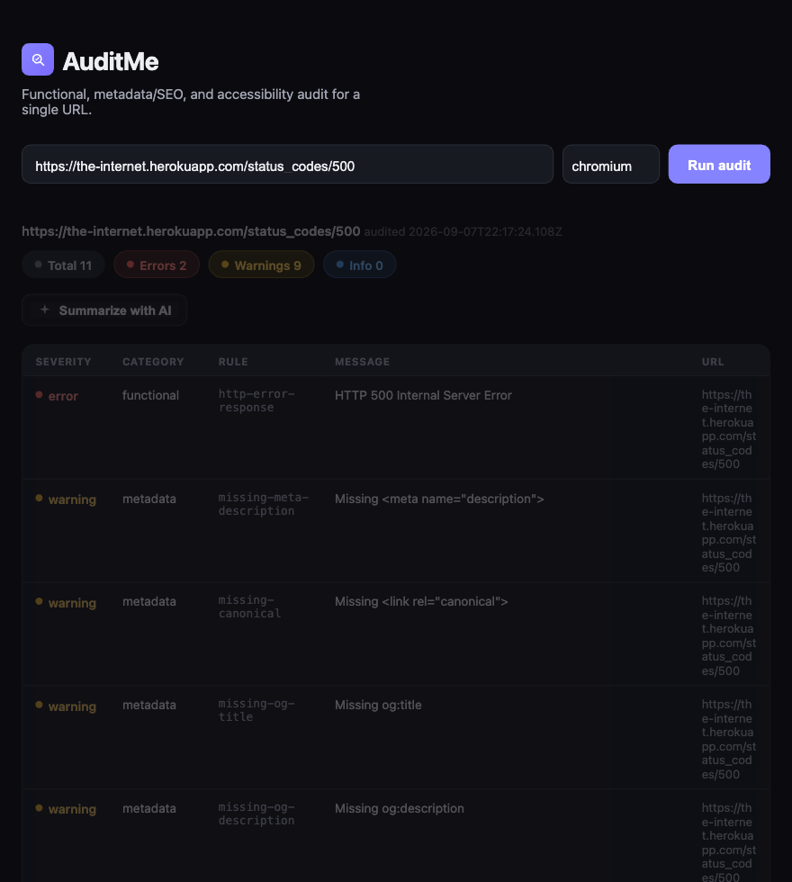

# AuditMe

Node.js + Playwright tool that audits a URL for functional, metadata/SEO, and accessibility issues. Ships two ways to use it: a CLI, and a small web app (Express API + React frontend) that wraps the same audit engine.



**Live:** [auditme.onrender.com](https://auditme.onrender.com) — free-tier hosting, so it spins down after 15 minutes idle and the first request after that can take 30-60s to wake back up. Public endpoints are rate-limited (20 requests / 15 min per IP on `/api/audits` and `/api/summary`) — see [API](#api) below.

The free tier's CPU allocation is small (0.15 CPU, confirmed from Render's own dashboard) — measured directly against a container resource-limited to match it: even `example.com` takes 25-32s, and a real, only moderately complex page (a Wikipedia article) didn't finish auditing within 120s. Small/simple sites audit reliably; large or complex ones may time out — that's a hosting-tier ceiling, not a bug, and audits now fail cleanly with a clear error rather than hanging or crashing the server when they hit it (see [Performance](#performance-known-limits) below).

## CLI usage

```bash
npm install
npx playwright install chromium

node audit.js https://the-internet.herokuapp.com/status_codes/500
node audit.js https://example.com --format both --output ./output
```

Exit code is `1` when any finding has severity `error` (usable as a CI gate).

### CLI options

| Flag | Description |
| --- | --- |
| `-f, --format <type>` | `json` (default), `html`, or `both` |
| `-o, --output <dir>` | Write `audit.json` / `audit.html` here |
| `--browser <name>` | `chromium` (default), `firefox`, or `webkit` |
| `--timeout <ms>` | Navigation timeout (default `30000`) |
| `--no-headless` | Show the browser window |
| `-q, --quiet` | Do not print the report to stdout |

Navigation waits for `domcontentloaded`, not the full `load` event — full `load` blocks until every subresource finishes (ads, trackers, images), which dominates audit time on heavy sites (measured ~2x slower on a content-heavy news homepage). The functional check's HTTP-error/JS-error listeners stay attached throughout regardless, so this doesn't change what a single `page.goto()` itself can detect — it only shortens the window (bounded by how long the metadata/accessibility checks below it take) for a slow subresource to still fail before the browser closes.

## Performance / known limits

- **One audit runs at a time by default** (`MAX_CONCURRENT_AUDITS`, default `1`). Each audit launches a full browser process; on a CPU/memory-constrained host, running more than one concurrently doesn't make audits faster — measured directly: CPU stayed pegged at the same ~15% on a 0.15-CPU container regardless of how many audits ran at once, while memory climbed from a 76MB baseline to 312MB with just 3 concurrent audits (on a 512MB-limited container, that's most of the way to an OOM kill). Serializing is a pure win on a host this constrained, not a trade-off — raise it only on a host with real spare CPU/RAM.
- **The whole audit (not just navigation) is bounded by an overall timeout** (`navigation timeout × 2`, so `60000ms` by default), after which the browser is force-closed rather than left running. `page.goto()`'s own timeout only covers navigation — a complex page can still run long in the metadata/accessibility checks that follow it, and without this bound that could hang indefinitely while holding its memory.
- **Large or complex pages may still time out, even on a correctly-configured host.** Tested and ruled out as a fix: blocking image/font/media requests during navigation (the obvious lever for a "heavy page") made no meaningful difference — a real Wikipedia article still didn't finish auditing within 120s at 0.15 CPU even with those blocked. The bottleneck there is CPU-bound DOM/accessibility-rule evaluation, not network weight, so it isn't something this codebase can optimize away — it's a real hosting-tier ceiling. `AUDIT_NAV_TIMEOUT_MS` (see `.env.example`) lets you raise the budget on a given host; a tier with real CPU headroom is the actual fix if consistently auditing large sites matters.

## Web app usage

The same `runAudit()` engine is wrapped in a small Express API, with a React (Vite) frontend to drive it from a browser instead of the CLI. Live at [auditme.onrender.com](https://auditme.onrender.com) — see the note at the top of this README on cold starts and rate limits. To run it locally instead:

```bash
npm install
npx playwright install chromium
npm --prefix web install

cp .env.example .env
# edit .env and set a real GEMINI_API_KEY if you want the AI summary
# feature to work — everything else runs fine without it
```

**Dev mode** (frontend hot-reloads, proxies API calls to the backend):

```bash
npm run server              # terminal 1 — API on http://localhost:3001
npm --prefix web run dev    # terminal 2 — UI on http://localhost:5173
```

**Single-port demo mode** (build the frontend once, Express serves both API and UI):

```bash
npm run build    # builds web/dist
npm run server   # http://localhost:3001 serves the built UI + API
```

### API

| Endpoint | Description |
| --- | --- |
| `GET /api/health` | Liveness check |
| `POST /api/audits` | Body: `{ "url": "...", "browser"?: "chromium"\|"firefox"\|"webkit", "timeout"?: ms }`. Returns the same result shape as the CLI's JSON output. `400` for a missing/malformed `url` or unsupported protocol/browser, `502` if the audit itself fails (bad host, navigation timeout, etc). |
| `POST /api/summary` | Body: `{ "result": <an audit result from POST /api/audits> }`. Asks Gemini for a short, prioritized, plain-English summary of the findings. Always `200` — `{ "summary": "..." }` either way, even on failure (a missing `GEMINI_API_KEY`, a Gemini API error) the `summary` field just explains what went wrong, so a flaky/unconfigured LLM call never breaks the audit flow. `400` only for a missing/malformed `result`. |

Only `http`/`https` URLs are accepted for `/api/audits`. This is a basic input guard, not full SSRF protection — it doesn't block private/internal IP ranges. Known limitation for the public deployment, not something to work around casually.

`/api/audits` and `/api/summary` are rate-limited to 20 requests / 15 minutes per IP (`429` past that, with standard `RateLimit-*` response headers) — the two routes that spend real compute or API quota, not `/api/health`. This is a basic abuse guard for a public demo, not hardened protection.

### AI summary

`lib/llmSummary.js` calls Gemini's REST API directly (no SDK dependency — Node's built-in `fetch` is enough). Separate, on-demand endpoint rather than something every audit triggers automatically: keeps `POST /api/audits` fast/deterministic and avoids spending API quota when nobody asked for a summary. In the UI, a "Summarize with AI" button appears once audit results are in.

Without a `GEMINI_API_KEY` configured, `/api/summary` still responds `200` with a `summary` string explaining that the LLM summary is unavailable — the rest of the app works normally either way.

## Project structure

```
audit.js              CLI entrypoint (commander)
lib/runner.js         Browser launch + check orchestration
lib/llmSummary.js     Gemini-powered plain-English summary of a result
checks/               One module per check category
  functional.js       HTTP >= 400, uncaught JS errors
  metadata.js          Title, description, canonical, OG, img alt
  accessibility.js    @axe-core/playwright
reports/              JSON + HTML formatters
server/               Express API wrapping lib/runner.js and lib/llmSummary.js
web/                  React (Vite) frontend
tests/                Node test runner + HTML fixtures
.github/workflows/    CI
Dockerfile             Container build for deployment (node:22-slim + Chromium)
```

Generated files go to `output/` (gitignored), not the `reports/` source folder. `web/dist/` (the frontend build) is also gitignored — build it locally with `npm run build`.

## Scripts

```bash
npm test
npm run audit -- <url>
npm run server
npm run build
```

## Test targets

Use [the-internet.herokuapp.com](https://the-internet.herokuapp.com/) for live failure scenarios (e.g. `/status_codes/500`). Check modules are unit-tested against local fixture pages so CI does not depend on that site.
